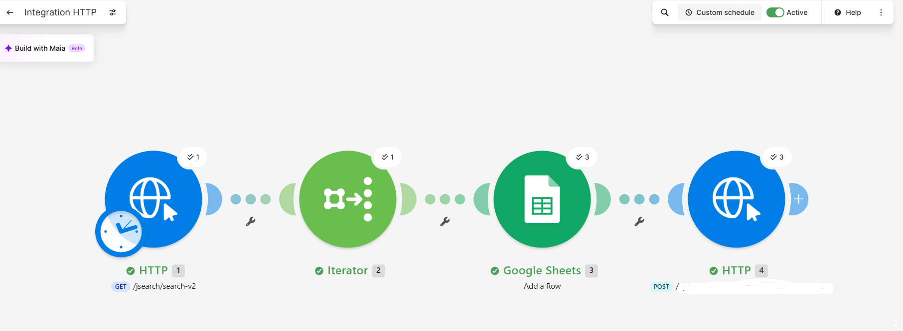

# Veille automatisée d'offres d'emploi Data Analyst

## Présentation du projet

Dans le cadre de ma formation Data Analyst, j'ai créé une automatisation avec Make pour effectuer une veille sur les offres d'emploi Data Analyst à Lille.

L'objectif est de récupérer automatiquement les offres d'emploi, de les enregistrer dans Google Sheets et de recevoir des notifications sur Discord.

## Fonctionnement

Le scénario Make utilise quatre modules :

1. HTTP : interroge l'API JSearch, fournie par OpenWeb Ninja, pour récupérer les offres d'emploi.
2. **Iterator** : parcourt les offres récupérées une par une.
3. **Google Sheets** : ajoute les informations de chaque offre dans un tableau de suivi.
4. **HTTP** : envoie une notification dans un salon Discord grâce à un webhook.
 
## Schéma de l'automatisation

Mon scénario Make comporte quatre modules reliés entre eux :

**HTTP (JSearch) → Iterator → Google Sheets → HTTP (Discord)**

- **HTTP (JSearch)** : recherche des offres d'emploi Data Analyst à Lille.
- **Iterator** : traite chaque offre individuellement.
- **Google Sheets** : enregistre les offres dans un tableau de suivi des candidatures.
- **HTTP (Discord)** : envoie une notification avec les informations et le lien pour postuler.

Le scénario est programmé pour s'exécuter chaque lundi à 8 h, heure de Paris.

### Capture du scénario

## Planification

Le scénario est programmé pour s'exécuter automatiquement **chaque lundi à 8 h**, heure de Paris.

## Outils utilisés

- Make
- API OpenWeb Ninja
- Google Sheets
- Discord
- GitHub

## Résultats

Les tests ont permis de vérifier que les offres sont correctement ajoutées dans Google Sheets et que les notifications arrivent dans Discord.

Le scénario est enregistré et activé.
## Présentation détaillée du projet

[📄 Consulter ma présentation](presentation-projet.md)
